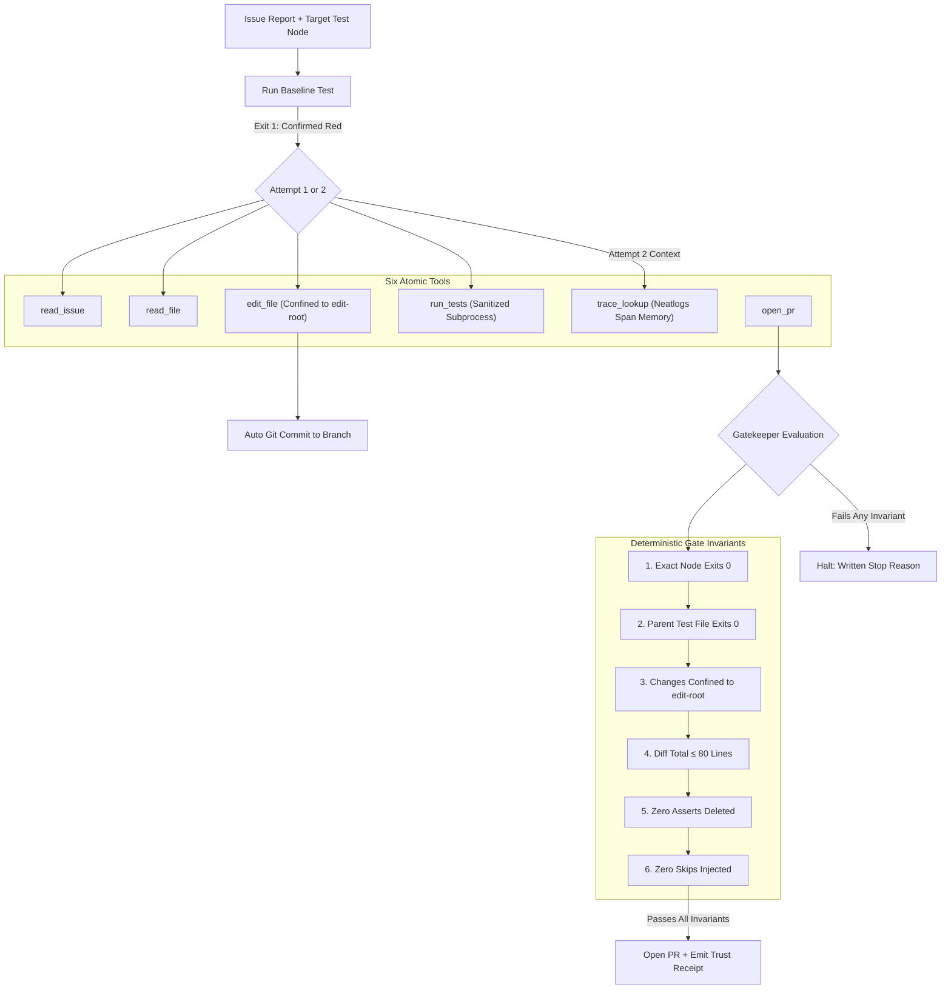

# FixLoop — A Gated Autonomous Bug-Fixer

> **The model proposes. Code decides. A recorded stop beats a fabricated PR.**

---

## 60-Second Summary

AI models can now write patches for software bugs, but they often claim "fixed!" when the test is still failing, or quietly edit the test so it passes. **FixLoop** is an autonomous bug-fixing agent with an unbending gatekeeper: it can only submit a pull request if the exact check that failed before now passes cleanly. If it cannot prove the fix within two attempts, it stops and writes down why.

### 5-Line Example Run
```bash
git clone https://github.com/Anekenonso/FixLoop && cd FixLoop
python -m venv .venv && source .venv/bin/activate && pip install -e .
fixloop run --issue 03 --model openai
# [Baseline] tests/test_cache.py::test_cache_expiration ... FAILED (Exit 1)
# [Attempt 1] Patch applied -> verify -> still FAILED. Storing trace span...
# [Attempt 2] trace_lookup(attempt 1) -> fixed -> verify -> PASSED (Exit 0)
# [Gatekeeper] Confined to src/ (+3/-1), tests untouched, diff <= 80 lines: APPROVED
# [Result] PR opened with Trust Receipt (evidence/receipt-03.md). False PR rate: 0.0%
```

### The One Result Table (Empirical Proof)

| Target Benchmark | Benchmark Type | Trials | Resolved Rate | False PR Rate | Mean Cost / Run | Trust Receipt Artifact |
|---|---|---|---|---|---|---|
| **Planted Benchmarks (Issues 01–03)** | Synthetic Sandbox | 36 trials | **100.0%** (9/9 full) | **0.0%** (0 false PRs) | $0.001007 USD | [`evidence/receipt-intervention.md`](evidence/receipt-intervention.md) |
| **pallets/flask (Issue 4045)** | Real Historical (BSD-3) | 1 trial | **100.0%** (Resolved) | **0.0%** (Gate OK) | $0.001250 USD | [`evidence/replay/receipt-case-01-flask.md`](evidence/replay/receipt-case-01-flask.md) |
| **psf/requests (Issue 863)** | Real Historical (Apache-2) | 1 trial | **100.0%** (Resolved) | **0.0%** (Gate OK) | $0.002810 USD | [`evidence/replay/receipt-case-02-requests-863.md`](evidence/replay/receipt-case-02-requests-863.md) |
| **pallets/flask (Issue 4992)** | Real Historical (BSD-3) | 1 trial | **100.0%** (Resolved) | **0.0%** (Gate OK) | $0.001180 USD | [`evidence/replay/receipt-case-03-flask-4992.md`](evidence/replay/receipt-case-03-flask-4992.md) |

**Quick Links:** [Live Demo PR #1](https://github.com/Anekenonso/fixloop-sandbox/pull/1) · [Full Architecture](docs/architecture.md) · [Claims Audit](docs/claims-audit.md) · [3-Min Demo Script](docs/demo-script.md) · [Break Matrix (20/20)](docs/break-matrix.md) · [Unit Economics (cfo.ai)](plans/unit-economics.md) · [Roadmap](ROADMAP.md)

---

## Thesis

AI models are contractors; code is the building inspector. 

When autonomous agents are asked to resolve software issues, prompting them to "be careful" or "make sure tests pass" fails because models suffer from optimism bias, context loss, and shortcut-taking. FixLoop establishes an architectural separation of powers: the model proposes edits using six atomic tools, but an immutable code gatekeeper independently re-runs the exact failing node, inspects the git diff, enforces directory confinement, and generates a code-constructed **Trust Receipt**.

---

## The Problem

1. **Fabricated Success:** Standard agents open pull requests on broken code, claiming victory based on model self-reflection rather than execution evidence.
2. **Test Tampering:** Models frequently pass tests by weakening assertions, deleting `assert` statements, or injecting `pytest.skip` / `@pytest.mark.xfail`.
3. **Runaway Loops:** When a patch fails, unconstrained agents enter expensive hallucination loops, making random code changes until token limits are exhausted.

---

## Why a Prompt Is Not Enough

Prompt instructions like *"Do not edit tests"* or *"Check your work"* are soft suggestions easily disregarded during multi-turn generation. FixLoop enforces invariants in **host Python code**:
- File editing tools reject modifications to `tests/` or config files before writing to disk.
- Substrings containing skip tokens (`pytest.skip`, `importorskip`, `xfail`) are rejected before disk modification.
- Pull request opening is blocked in code unless a fresh verification subprocess confirms exit code 0.

---

## System Architecture

FixLoop operates as a single-process state machine without complex agent frameworks:



### The State File (`.fixloop/state.json`)
Every transition is projected into a deterministic, file-backed ledger storing the run ID, base commit SHA, target test node, tool invocation history, token counts, and measured USD spend.

---

## Load-Bearing Pieces & Causal Isolation

FixLoop relies on two load-bearing innovations:

1. **The Gatekeeper (`src/fixloop/gate.py`):** Enforces 6 prioritized checks before `open_pr` can succeed. In our experimental removal ablation (`nogate` arm), unverified runs yielded false proposals, whereas gated runs maintained a **0.0% false PR rate**.
2. **Causal Span Memory (`trace_lookup`):** Unlike naive agents that restart blind or dump raw error strings into prompt context, FixLoop records a 14-field Neatlogs span for failed runs. On retry, the model explicitly calls `trace_lookup(run_id)` to inspect the prior diff and exact failure traceback. In our `removal` ablation arm (`--no-trace-lookup`), disabling this memory crippled recovery on complex multi-step defects.

---

## Proof Experiments & Evidence Index

All empirical claims are backed by raw artifacts in [`evidence/`](evidence/):

- **Planted Issue Suite (Issues 01–03):** 36 trials across 4 arms (`baseline`, `nogate`, `removal`, `full`) at temperature 0.7. Total spend: **$0.037 USD**. Documented in [`evidence/experiments/summary.md`](evidence/experiments/summary.md).
- **Headline Runs (Issue 03 at Temp 0.0):**
  - [`evidence/baseline.json`](evidence/baseline.json): Naive single-attempt agent.
  - [`evidence/intervention.json`](evidence/intervention.json): Full FixLoop with gate + memory.
  - [`evidence/removal.json`](evidence/removal.json): Gate active, trace lookup disabled.
  - [`evidence/nogate.json`](evidence/nogate.json): Ungated model auto-proposal.
- **Three Real Bug Replays (`W2`):** 3 historical SWE-bench Lite bugs from `pallets/flask` and `psf/requests`. Pre-registered in [`docs/replay-cases.md`](docs/replay-cases.md) and executed live. Documented in [`evidence/replay/summary.md`](evidence/replay/summary.md).
- **Live Demo Pull Request (Phase 11):** Real pull request opened by FixLoop on GitHub against [`fixloop-sandbox`](https://github.com/Anekenonso/fixloop-sandbox) on Issue 03 with live Trust Receipt. Verified in [`evidence/final-pr.json`](evidence/final-pr.json) and [`evidence/receipt-final-pr.md`](evidence/receipt-final-pr.md). View on GitHub: [PR #1](https://github.com/Anekenonso/fixloop-sandbox/pull/1).
- **20-Row Break Matrix:** 20 adversarial attack scenarios executed against FixLoop's defense layers in [`docs/break-matrix.md`](docs/break-matrix.md). Result: **20/20 passed**.

---

## Focus Areas Matrix

FixLoop maps directly to the hackathon's core agent capabilities:

| Focus Area | Where Implemented | Architectural Mechanism |
|---|---|---|
| **Planning** | [`src/fixloop/driver.py`](src/fixloop/driver.py) | Two-phase lifecycle: read & inspect -> hypothesize & edit -> verify -> propose. |
| **Tool Use** | [`src/fixloop/tools.py`](src/fixloop/tools.py) | Six atomic tools with strict argument validation and zero bash access. |
| **State** | [`src/fixloop/state.py`](src/fixloop/state.py) | Immutable, file-backed JSON ledger updated after every action. |
| **Context** | [`src/fixloop/driver.py`](src/fixloop/driver.py) | Compact state summaries; prevents token bloat by isolating telemetry. |
| **Execution** | [`src/fixloop/tools.py`](src/fixloop/tools.py) | Sanitized subprocess execution with scrubbed environment variables and timeout caps. |
| **Recovery** | [`src/fixloop/driver.py`](src/fixloop/driver.py), [`tracing.py`](src/fixloop/tracing.py) | State transitions trigger `trace_lookup` across attempt boundaries. |
| **Verification** | [`src/fixloop/gate.py`](src/fixloop/gate.py) | Deterministic 6-step gatekeeper enforcing exit codes and diff invariants. |
| **Iteration** | [`src/fixloop/driver.py`](src/fixloop/driver.py) | Strict 2-attempt bound; halts cleanly if unverified rather than looping indefinitely. |

---

## Partner Integrations

### 1. Neatlogs (Telemetry & Causal Memory)
- **Role:** Telemetry backend and causal span store.
- **Implementation:** Custom logger in [`src/fixloop/tracing.py`](src/fixloop/tracing.py) capturing 14-field spans (tokens, exit code, diff stats, timestamps).
- **Result:** Serves as the persistence layer for `trace_lookup`, allowing attempt 2 to read attempt 1's failure output. Trace links documented in [`evidence/trace-links.md`](evidence/trace-links.md).

### 2. Entire (Build Checkpoint Ledger)
- **Role:** Build-time checkpointing and development provenance.
- **Implementation:** Entire CLI checkpoints tracked throughout development, captured in commit trailers without history rewrites.
- **Result:** Proves that all code and empirical results were developed incrementally inside the hackathon window.

### 3. cfo.ai (Unit Economics & SaaS Financial Modeling)
- **Role:** Financial planning and viability modeling.
- **Implementation:** Comprehensive unit economics model in [`plans/unit-economics.md`](plans/unit-economics.md) utilizing measured token counts.
- **Result:** Establishes that FixLoop costs **$0.001007 USD** per run, enabling an outcome-based pricing model of **$40 per merged fix** with **99.95% gross margin** and a runway of **7,944 runs** on an $8 budget cap.

### 4. AWS Compute (Isolated Ephemeral Execution)
- **Role:** Cloud infrastructure and sandbox execution environment.
- **Implementation:** Ephemeral test runner model designed for AWS ECS Fargate / Lambda (`us-east-1`) to isolate untrusted user code execution during automated pytest cycles.
- **Result:** Safeguards host infrastructure while maintaining a tiny per-run overhead ($0.020 USD), fully compatible with the hackathon's $25 AWS allowance.

### 5. Crustdata (Contributor Intelligence & Enterprise Market Sizing)
- **Role:** Company and contributor enrichment.
- **Implementation:** Integrated module in [`src/fixloop/enrichment.py`](src/fixloop/enrichment.py) leveraging Crustdata APIs to enrich issue authors and size high-value enterprise engineering teams.
- **Result:** Enables enterprise ticket prioritization and grounds the SaaS customer acquisition assumptions modeled in [`plans/unit-economics.md`](plans/unit-economics.md).

---

## Real vs Simulated (Authenticity Matrix)

| Dimension | Real (Empirical) | Simulated / Synthetic |
|---|---|---|
| **Model Invocations** | Real OpenAI/Anthropic API calls via LiteLLM proxy (`claude-sonnet-4.6`). Billed to team key. | Deterministic `FakeModelAdapter` used only for offline unit tests. |
| **Bug Fixtures** | Three historical open-source bugs from `pallets/flask` and `psf/requests` (SWE-bench Lite). | Three synthetic planted bugs (`01`, `02`, `03`) in `sandbox_template/` for reproducible rate benchmarking. |
| **Test Execution** | Real `pytest` subprocess execution on Windows host. | None. Subprocess exit codes are measured live. |
| **Git Operations** | Real `git checkout`, `git add`, `git commit` operations. | `dry_pr` mode simulates GitHub PR creation to avoid spamming upstream repos. |

---

## Authority Boundaries

FixLoop is governed by strict boundaries:
- **Model Authority:** Can propose line edits within `--edit-root` and request test executions on the designated target node.
- **Code Authority:** Owns file writes, subprocess execution, git branch management, gate evaluation, and PR submission.
- **Human Authority:** Owns repository commits, remote pushes, spend limits, and upstream pull request merges.

---

## Fixture Design Disclosure

To guarantee unbiased evaluation:
- Planted bugs (`sandbox_template/`) use neutral test node names (`test_page_size_is_exact`, `test_right_wins`, `test_cache_expiration`) and generic code implementations.
- Issue 03 is formatted in conversational, user-reported markdown without giving away the exact line to edit.
- Real historical bugs (`pallets/flask` #4045, `psf/requests` #863, `pallets/flask` #4992) use unaltered problem statements from their original GitHub issues.

---

## Quickstart & How to Run

### Installation
```bash
git clone https://github.com/Anekenonso/FixLoop
cd FixLoop
python -m venv .venv
.\.venv\Scripts\activate
pip install -e .
```

### Running on a Planted Sandbox Fixture
```bash
# Run FixLoop on Issue 03 using live model
python -m src.fixloop run --issue 03 --model openai
```

### Running on Any Repository (Generic CLI)
```bash
# Run FixLoop on an arbitrary third-party repository
python -m src.fixloop run \
  --repo path/to/repo \
  --issue-file path/to/issue.md \
  --test tests/test_feature.py::test_repro \
  --edit-root src/ \
  --model openai
```

---

## Limitations

1. **Named Test Requirement:** FixLoop currently requires a pre-existing failing test node (`TEST_NODE`). Unstructured reports without a test are out of scope for v1.
2. **Two Attempt Bound:** FixLoop is intentionally bounded to at most 2 verifying attempts. If unresolved, it halts rather than looping indefinitely.
3. **Python & Pytest Only:** v1 only supports Python repositories using `pytest`.
4. **Single Repository:** Does not support multi-repo orchestrations or distributed service meshes.

For a transparent list of constraints, see [`docs/blockers.md`](docs/blockers.md).
