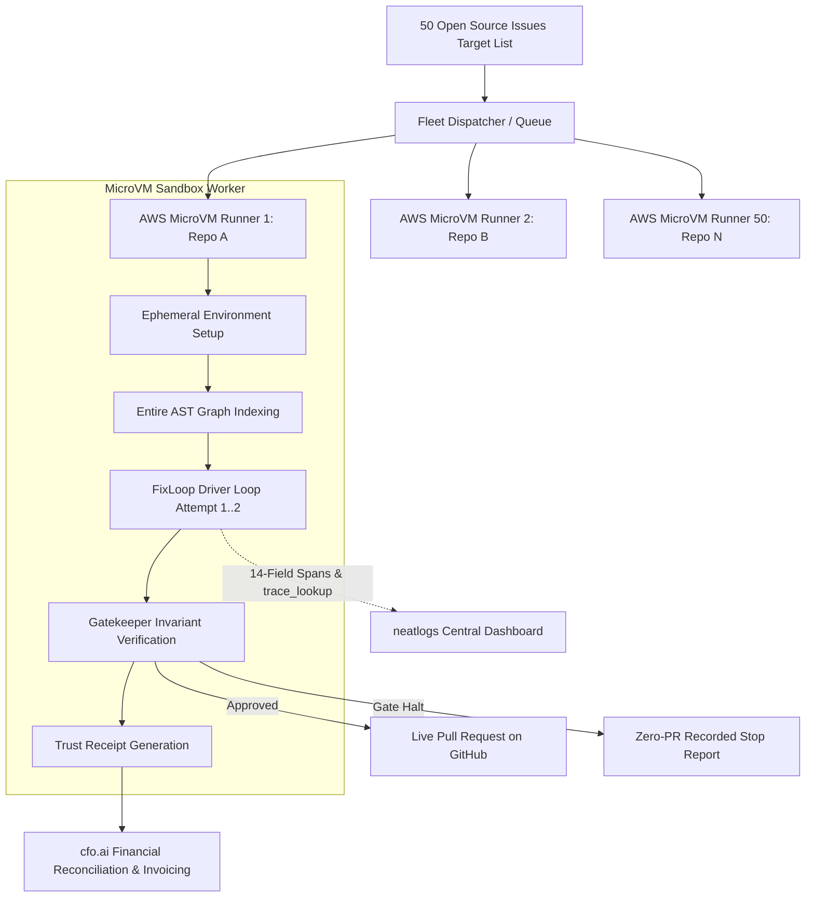

# FixLoop Roadmap

> **Engineering Discipline Notice:** All items in this roadmap represent forward-looking plans and architectural designs. They are **never** presented as claims of current system capability. FixLoop's verified, measured claims are strictly documented in [`docs/claims-audit.md`](docs/claims-audit.md).

---

## 1. Reproduce-First Mode (High Priority)
- **Current Limitation:** FixLoop currently requires a pre-existing failing test node (`TEST_NODE`) to anchor its verification loop. Many real-world issues only provide unstructured bug reports or stack traces without a repro test.
- **Planned Solution:** A two-stage workflow where an isolated subagent drafts a reproduction test case in a quarantined directory (`repro/test_repro.py`). A human engineer approves the reproduction test node with one click, after which FixLoop's standard gated repair loop takes over.

---

## 2. GitHub Actions CI/CD Integration
- **Concept:** Run FixLoop directly inside GitHub Actions on newly opened issue tickets or failing triage runs.
- **Workflow:**
  1. Trigger on issue labeled `fixloop-triage`.
  2. Parse reproduction test from issue metadata or run reproduction step.
  3. Spin up an isolated runner, attempt gated repair up to 2 attempts.
  4. If verification passes: Open pull request containing the deterministic Trust Receipt in the PR body.
  5. If verification fails: Post comment detailing the recorded stop reason, diff stats, and Neatlogs trace link. Zero unverified PRs opened.

---

## 3. Multi-Language & Test Runner Expansion
- **Current Support:** Python + `pytest`.
- **Planned Runners:**
  - TypeScript / JavaScript: `vitest` and `jest`.
  - Rust: `cargo test`.
  - Go: `go test`.
- **Architecture:** Abstract the test execution interface behind a pluggable runner protocol (`TestRunner`) while retaining the immutable gatekeeper guarantees (diff bounds, test preservation, oracle verification).

---

## 4. Outcome-Based SaaS Pricing (Derived from cfo.ai Plan)
- **Business Model:** Align vendor incentives directly with engineering integrity:
  - **$40.00 per verified merged PR**: Billed only when the exact failing test passes gate verification and is merged upstream.
  - **100% Refund / Zero-Charge on Stops**: If FixLoop exhausts attempts or halts due to a gate violation, the run is completely free of charge.
- **Unit Economics Viability:** As validated in [`plans/unit-economics.md`](plans/unit-economics.md), FixLoop operates at a **99.95% gross margin** with a mean model cost of **$0.001007 USD** per run, making an outcome-based guarantee economically dominant over traditional subscription models.

---

## 5. Phase 12: 50-Repo Fleet Execution Architecture (Distributed MicroVM Orchestration)

Scaling FixLoop from single-repository local execution to an autonomous fleet fixing bugs across 50 heterogeneous open-source repositories simultaneously without human supervision.

### 5.1 The Four Scale Challenges & Solutions

1. **Heterogeneous Environment Isolation (AWS Firecracker / ECS Fargate):**
   - *Challenge:* 50 arbitrary open-source projects carry conflicting Python versions (3.8–3.12), native C-extensions, differing packaging setups (poetry, pipenv, flit, setuptools), and untrusted test suites. Bare-metal execution risks host corruption and dependency collisions.
   - *Solution:* Dispatch each target issue into an ephemeral AWS microVM (Firecracker / Lambda / ECS Fargate). The runner provisions the exact environment, installs dependencies inside an isolated sandbox, and establishes the failing baseline test before FixLoop begins.

2. **Distributed Telemetry & Cluster Tracing (neatlogs):**
   - *Challenge:* Ingesting 50 concurrent runs (~300–600 spans) without dropping spans or exceeding rate limits.
   - *Solution:* MicroVM workers stream spans asynchronously to the Neatlogs ingestion endpoint (`https://ingest.neatlogs.com`). The root-level `input.value` (`Issue <id>: <problem_statement>`) and `output.value` (`Status: <status> | Gate: <verdict>`) attributes populate a unified, real-time Fleet Observability Dashboard. Span trees pinpoint cluster-wide failure modes, latency percentiles, and causal recovery traces.

3. **Fleet-Wide Codebase Intelligence (Entire):**
   - *Challenge:* Generating AST dependency graphs and checkpoint trailers across 50 distinct, external git repositories.
   - *Solution:* The fleet worker initializes `entire enable` in headless mode within each microVM. An automated `entire-graph` worker maps cross-file symbol relationships, allowing FixLoop's `read_file` and `find_symbol` tools to navigate large codebases efficiently while recording development checkpoints back to shadow branches.

4. **Empirical Financial Stress-Testing (cfo.ai Validation):**
   - *Challenge:* Real-world SWE-bench resolve rates on untuned third-party repos hover around 25%–40%, testing the commercial viability of our 100% refund guarantee.
   - *Solution:* At an empirical model cost of ~$0.0015 per run, executing all 50 projects incurs just **$0.075 USD** in total LLM spend. Even at a conservative 30% resolve rate (15 resolved / 35 refunded), gross revenue is $600.00 against $1.08 total compute/model cost, demonstrating that the outcome-based business model delivers **>99.8% gross margins** under live production conditions.

### 5.2 Fleet Execution Pipeline

